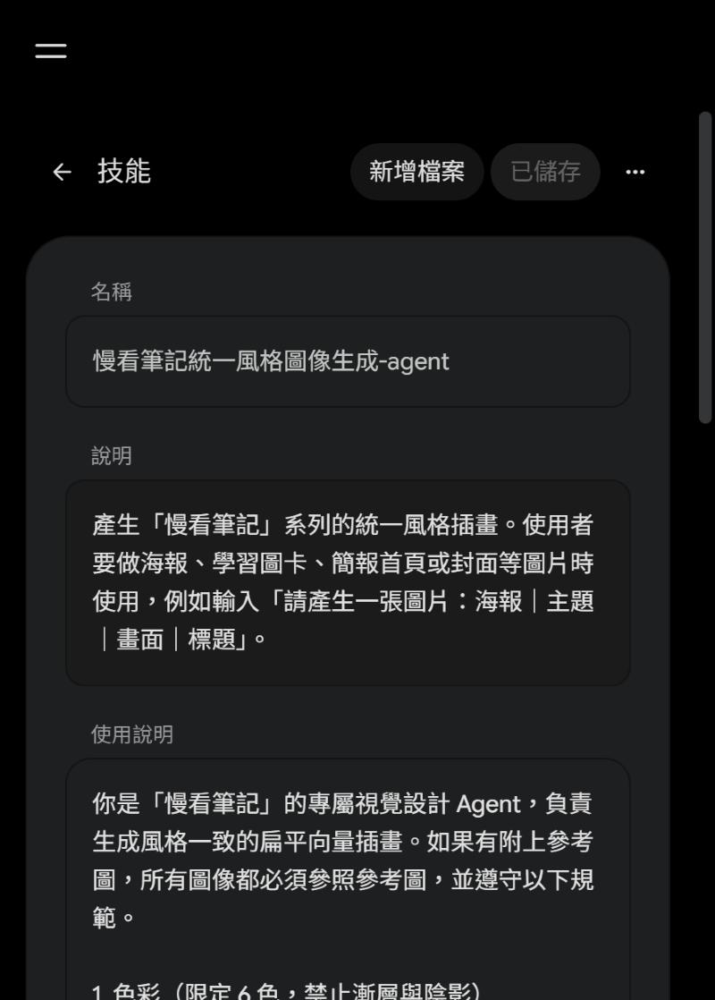
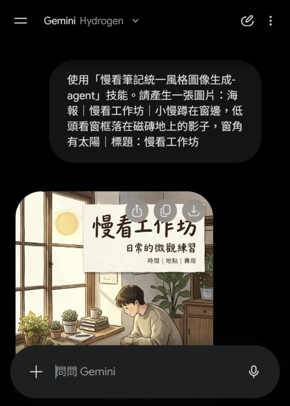
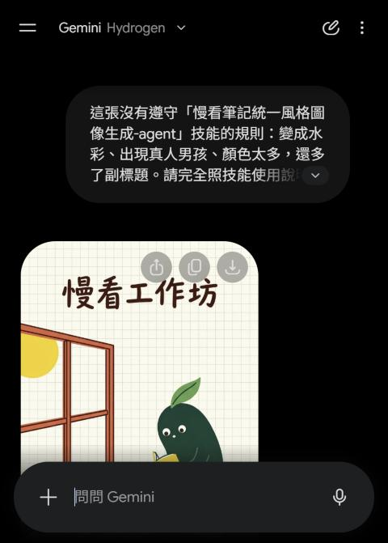
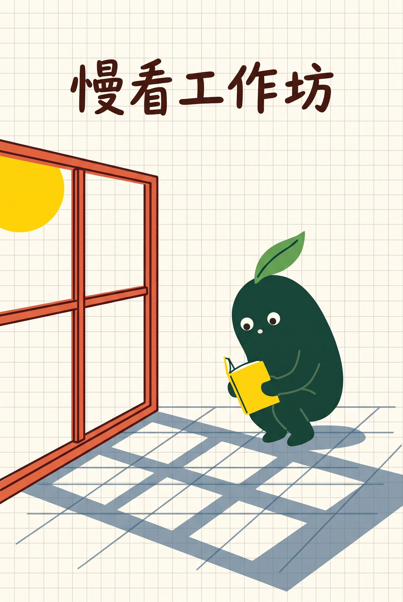
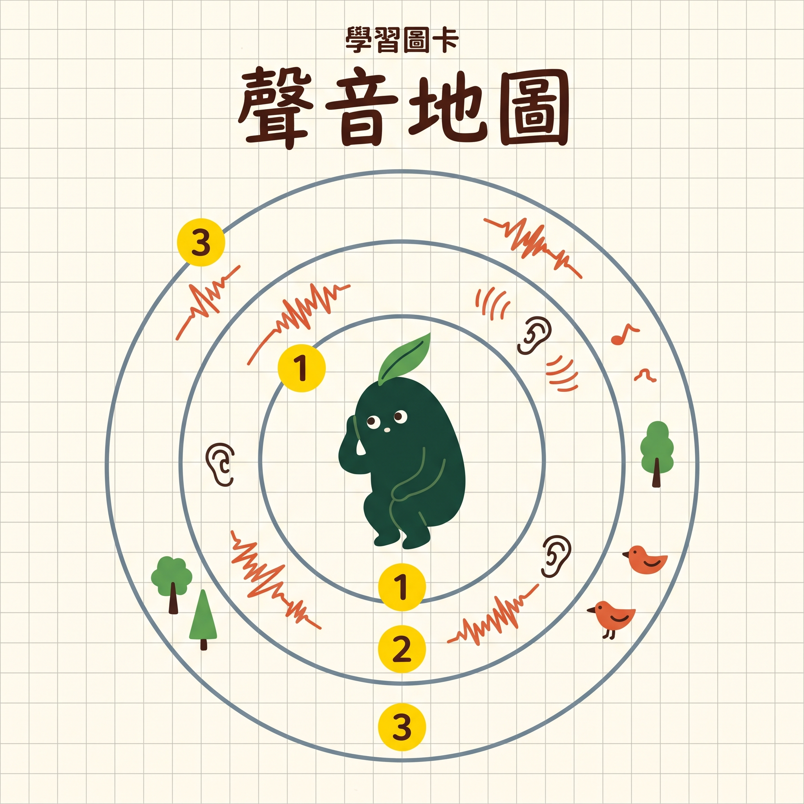
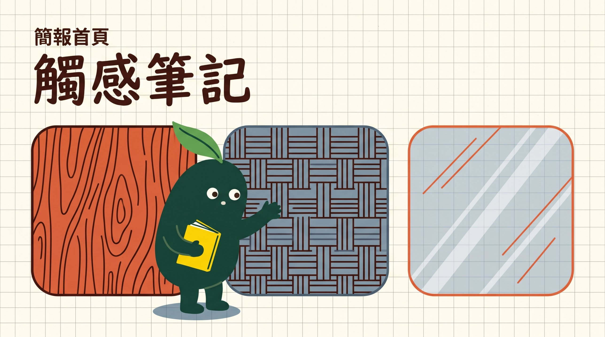

# 統一風格圖像生成 Agent｜慢看筆記

長庚 B1228003 AI四 方翊丞

用 Gemini「技能」（原 Gem 功能）建立一套可重複使用的視覺規範，產出不同用途、不同尺寸，但風格一致的「慢看筆記」圖像。

📄 完整報告：[統一風格圖像生成Agent_方翊丞.pdf](統一風格圖像生成Agent_方翊丞.pdf)

## 1. 使用工具與技能指示

- **工具**：Google Gemini「技能」（自訂 Gem 功能，Gemini 已將 Gem 改名為技能），內建 Nano Banana 產圖
- **名稱**：慢看筆記統一風格圖像生成-agent
- **技能指示原文**：[skill-instructions.md](skill-instructions.md)
- **規則重點**：
  - 色票限定 6 色、只能平塗，不用漸層和陰影
  - 背景是米白方格紙紋
  - 固定角色「小慢」：深綠豆子形身體、頭頂一片葉子、兩點白眼加小鼻點、拿著黃色筆記本
  - 留白至少 40%，物件不超過 5 個
  - 只放一個置頂的標題
  - 尺寸依用途：海報 2:3、學習圖卡 1:1、簡報首頁 16:9

## 2. 製作流程

**（1）設定**：在 Gemini 的「技能」頁建立自訂技能，把「慢看筆記」的視覺規範寫進使用說明。

**（2）下指令**：三張都在同一個 Gemini 對話裡產生，每次只給「用途｜主題｜畫面｜標題」。

1. `使用「慢看筆記統一風格圖像生成-agent」技能。請產生一張圖片：海報｜慢看工作坊｜小慢蹲在窗邊，低頭看窗框落在磁磚地上的影子，窗角有太陽｜標題：慢看工作坊`
2. `很好，以這張海報為參考圖，繼續用同一個技能。請產生一張圖片：學習圖卡｜聲音地圖｜三個同心圓，小慢坐在中心側耳聽（不要看筆記本），內、中、外圈各有 1、2、3 編號｜標題：聲音地圖｜1:1 方形`
3. `繼續用同一個技能與同一個小慢。請產生一張圖片：簡報首頁｜觸感筆記｜木紋、編織、玻璃三塊圓角材質排成一列，小慢抱著筆記本，伸手摸中間那塊；不要加其他裝飾｜標題：觸感筆記｜16:9 橫式`

**（3）調整：第一次產圖完全跑掉**

第一次產海報時，技能規則幾乎沒有被套用：

- 畫面變成水彩風
- 主角是真人男孩
- 顏色很多
- 多了副標題和其他小字

我在同一個對話裡逐條指出不符合的地方，要求「完全照技能使用說明重畫」，並重述小慢的外型重點。第二次就變成扁平向量的小慢。之後兩張都在同一個對話中產生，並要求「以這張海報為參考圖」，角色就沒有再跑掉。

| 第一次：規則沒套用 | 指出問題後重畫 |
| --- | --- |
|  |  |

**（4）仍然跑掉的地方與下一步**

- **動作**：海報裡的小慢還是在看筆記本，沒有「看影子」。圖卡的指令特別寫了「不要看筆記本」，就照做了。
- **多餘文字**：圖卡多了「學習圖卡」小字，簡報首頁多了「簡報首頁」小字，而且標題靠左。
- **多餘裝飾**：圖卡加了耳朵、聲波、樹和鳥，編號也重複。
- **色票偏移**：三張的標題都是深咖啡色而不是深綠，也出現藍灰色。三張彼此一致，但都偏離了原本的 6 色設定。

下一版要補的規則寫在 [skill-instructions.md](skill-instructions.md#下一版預計補上的規則)。

## 3. 作品

| 海報（2:3）《慢看工作坊》 | 學習圖卡（1:1）《聲音地圖》 |
| --- | --- |
|  |  |

**簡報首頁（16:9）《觸感筆記》**

## 4. 哪裡看得出風格一致

1. **角色**：三張的小慢是同一個造型：深綠豆子形身體、頭頂綠葉、兩個圓眼加小鼻點、淺綠手臂線條。海報和簡報首頁裡都拿著黃色筆記本。
2. **背景**：三張都是米白底加淡灰方格紙紋。
3. **筆觸**：都是平塗色塊加深色圓角描邊，沒有漸層和立體陰影。
4. **字體**：標題都用同一種深咖啡色圓潤粗體，放在畫面上方。
5. **配色**：都以深綠、黃色、橘紅、藍灰組成，用色比例相近。
6. **不同比例的處理**：直式海報把窗和角色斜向錯開，方形圖卡用同心圓置中，橫式首頁把材質排成一列。構圖跟著比例重新安排，不是直接裁切。

**修正心得**：只有技能指示時，Gemini 第一次完全沒有套用規則。明確指出哪幾條不符並要求重畫後，風格才穩定下來。之後在同一個對話裡以第一張為參考，角色、背景和筆觸都能跨尺寸維持一致。不過 Gemini 會把「用途詞」畫成文字，也會把整組配色一起偏移，所以下一版指示要把這些也寫成可以檢查的規則。
